# 论 LLM 推理中 RLVR 更新的方向：识别与利用

> 原文：*On the Direction of RLVR Updates for LLM Reasoning: Identification and Exploitation*
> 作者：Qwen Pilot Team, Alibaba Group\*（完整作者名单见“贡献”一节）
> arXiv:2603.22117v1 [cs.LG]，2026 年 3 月 23 日
>
> 译注：本译文按原文章节组织。公式依据 PDF 文本抽取结果重排为 LaTeX，符号与原文保持一致；表格依据抽取数值重建，并与正文图中的数值逐一核对过。图片内容无法翻译，仅翻译图题，并在必要处简述图中各子图的标题。参考文献保留英文原文。

---

## 摘要（Abstract）

基于可验证奖励的强化学习（reinforcement learning with verifiable rewards，RLVR）显著提升了大语言模型的推理能力。现有分析已指出 RLVR 引起的变化是稀疏的，但这些分析主要关注更新的**幅度（magnitude）**，在很大程度上忽视了更新的**方向（direction）**。在本工作中，我们认为更新方向是理解 RLVR 作用的一个更关键的视角，它可以由基座模型与最终 RLVR 模型之间带符号的、token 级的对数概率差 $\Delta \log p$ 来刻画。通过统计分析和 token 替换干预实验，我们证明：与基于幅度的指标（例如散度或熵）相比，$\Delta \log p$ 能更有效地识别出稀疏但对推理至关重要的更新。基于这一洞见，我们提出两种实际应用：(1) 一种**测试时外推**方法，沿着学到的 $\Delta \log p$ 方向放大策略，无需额外训练即可提升推理准确率；(2) 一种**训练时重加权**方法，将学习集中在低概率 token（对应更高的 $\Delta \log p$）上，在多种模型和基准上提升了推理性能。我们的工作确立了“变化的方向”作为分析与改进 RLVR 的一项关键原则。

---

## 1 引言（Introduction）

近期的进展大幅提升了大语言模型的推理能力，催生了一批强大的以推理为核心的模型，例如 OpenAI o1（Jaech et al., 2024）、DeepSeek R1（Guo et al., 2025）、Gemini 2.5（Comanici et al., 2025）和 Qwen3（Yang et al., 2025a）。这一进展背后的一个关键算法驱动力是基于可验证奖励的强化学习（RLVR）（Guo et al., 2025; Team, 2025; Yang et al., 2025a）：它利用特定任务验证器（verifier）提供的反馈来微调模型的生成策略，从而激发并放大模型的推理能力。

为了阐明 RLVR 如何带来收益，一个自然的视角是比较最终经过 RL 训练的模型 $\pi_{RL}$ 相对于其基座模型 $\pi_{Base}$ 发生了哪些变化（Ren & Sutherland, 2025）。先前的分析一致表明，RLVR 引起的变化是**稀疏的**，只影响输出序列中一小部分 token。例如，Wang et al. (2025b) 将这些变化与高熵 token 联系起来；Huan et al. (2025) 通过度量 $\pi_{Base}$ 与 $\pi_{RL}$ 之间的 KL 散度佐证了这种稀疏性；而 Yang et al. (2025b) 与 Deng et al. (2025) 则将这种稀疏性归因于 RLVR 训练过程中的选择性梯度更新。然而，在研究基座模型与 RLVR 模型之间的差异时，已有研究主要强调变化的幅度，而在很大程度上忽略了其分布中的方向。如图 1(b) 所示，基于幅度的指标（如熵、KL 散度）在基座模型和最终 RLVR 模型上得到的直方图几乎完全相同，这说明仅凭幅度不足以刻画从 $\pi_{Base}$ 到 $\pi_{RL}$ 的转变。

为弥补这一空白，我们使用带符号的 token 级对数概率差，直接量化模型分布中的方向性偏移：

$$
\Delta \log p(y_t \mid x, y_{<t}) = \log \pi_{RL}(y_t \mid x, y_{<t}) - \log \pi_{Base}(y_t \mid x, y_{<t}), \tag{1}
$$

它刻画了 RLVR 如何改变每个 token 上的概率质量：正值表示概率上升，负值则相反。如图 1(b) 所示，$\Delta \log p$ 的直方图呈现出清晰的**双峰**模式，具有两条明显的尾部，凸显出一种基于幅度的指标所不具备的方向性特征。该指标能够揭示 RLVR 优先关注哪些 token，例如区分对推理至关重要的 token（如提升推理正确性的 token）与无关 token。我们进一步通过 token 替换干预（Meng et al., 2026）验证其效用：对于每种指标，我们识别出显著位置，并在生成过程中把这些位置上基座模型的 token 替换为 RLVR 模型的选择（参见算法 1）。如图 1(c) 所示，按 $\Delta \log p$ 进行选择能够以最少的替换次数达到 RLVR 级别的性能，精确定位了 RLVR 学到推理关键更新的那些 token。这些发现凸显了一个关键原则：**分析变化的方向，而不仅仅是其幅度，能够提供更深入的洞见**。带符号的对数概率差为这种诊断分析提供了一个实用且有效的抓手。


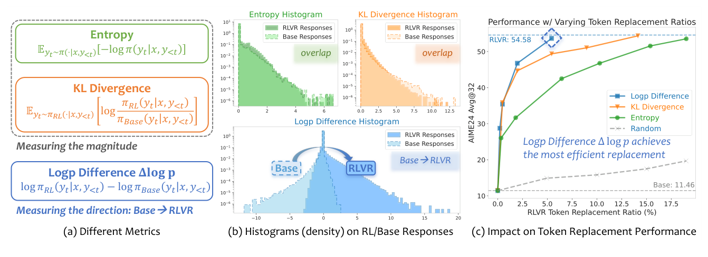

> **图 1（Figure 1）**：(a) 用于分析 RLVR 更新的 token 级指标。(b) 各指标在基座模型与 RLVR 模型所生成回复上的直方图。在对数刻度的 y 轴下，所有指标的大部分取值都集中在零附近，但只有 $\Delta \log p$ 表现出能够区分 RLVR 模型与基座模型的方向性偏移。(c) token 替换性能：在各指标所选位置上用 RLVR 的选择替换基座 token，其中 $\Delta \log p$ 以最少的替换次数恢复了 RLVR 的性能。
>
> （图中子图 (a) 列出三种指标：熵 $\mathbb{E}_{y_t\sim\pi(\cdot|x,y_{<t})}[-\log \pi(y_t|x,y_{<t})]$ 与 KL 散度 $\mathbb{E}_{y_t\sim\pi_{RL}(\cdot|x,y_{<t})}\big[\log \frac{\pi_{RL}(y_t|x,y_{<t})}{\pi_{Base}(y_t|x,y_{<t})}\big]$ 属于“度量幅度”，对数概率差 $\log \pi_{RL}(y_t|x,y_{<t}) - \log \pi_{Base}(y_t|x,y_{<t})$ 属于“度量方向：Base → RLVR”；子图 (b) 中前两者的 Base/RLVR 直方图重叠（overlap）；子图 (c) 标注“对数概率差 $\Delta \log p$ 实现了最高效的替换”。）

基于这一原则，我们首先提出一种**测试时增强**方法：针对推理关键 token，有选择地沿着 $\Delta \log p$ 方向对 RLVR 策略的分布进行外推，从而放大与推理相关的更新，在不进行额外训练的情况下提升准确率。此外，我们观察到，在 RLVR 训练过程中，$\Delta \log p$ 最大的 token 始终对应低概率 token。受此启发，我们设计了一种**概率感知的策略梯度优势重加权**方法，提高低概率 token 的贡献权重，使学习聚焦于 $\Delta \log p$ 所指示的推理关键位置。在多种基准和模型上，这种重加权在当前最先进的 RLVR 方法（如 DAPO（Yu et al., 2025））的基础上取得了额外收益。

综上，本文提出了一种用于分析 RLVR 作用的**方向性诊断**方法，并基于这些发现开发了两种实用的推理增强策略：一种测试时外推技术和一种训练时重加权方法。我们希望本工作能够从“更新方向”的视角，为分析和改进 RLVR 提供新的思路。

---

## 2 预备知识（Preliminaries）

**组相对策略优化（Group Relative Policy Optimization，GRPO）。** GRPO（Shao et al., 2024）是里程碑式策略梯度算法 PPO（Schulman et al., 2017）的一种变体。它通过去掉单独的 critic 模型，使其适用于 LLM 训练。对于从数据集 $\mathcal{D}$ 中采样的每个问答对 $(x, a)$，GRPO 使用旧策略 $\pi_{\theta_{old}}$ 生成一组 $G$ 个回复 $\{y_i\}_{i=1}^G$，计算它们的奖励 $\{R_i\}_{i=1}^G$，并以组内相对的方式估计每个回复的优势：

$$
\hat{A}_{i,t} = \frac{R_i - \mathrm{mean}(\{R_i\}_{i=1}^G)}{\mathrm{std}(\{R_i\}_{i=1}^G)}. \tag{2}
$$

随后，通过最大化如下目标来优化策略 $\pi_\theta$：

$$
\begin{aligned}
\mathcal{J}_{GRPO}(\theta) = \mathbb{E}_{(x,a)\sim\mathcal{D},\,\{y_i\}_{i=1}^G\sim\pi_{\theta_{old}}(\cdot\mid x)}
\Bigg[&\frac{1}{G}\sum_{i=1}^{G}\frac{1}{|y_i|}\sum_{t=1}^{|y_i|}
\Big(\min\big(r_{i,t}(\theta)\hat{A}_{i,t},\ \mathrm{clip}\big(r_{i,t}(\theta), 1-\epsilon, 1+\epsilon\big)\hat{A}_{i,t}\big) \\
&- \beta D_{KL}(\pi_\theta \,\|\, \pi_{ref})\Big)\Bigg],
\end{aligned} \tag{3}
$$

其中 $r_{i,t}(\theta) = \dfrac{\pi_\theta(y_{i,t}\mid x, y_{i,<t})}{\pi_{\theta_{old}}(y_{i,t}\mid x, y_{i,<t})}$ 为重要性采样比率，$\epsilon$ 为 $r_{i,t}(\theta)$ 的裁剪范围，$D_{KL}(\pi_\theta\|\pi_{ref})$ 用于约束策略使其保持接近参考策略 $\pi_{ref}$。

**动态采样策略优化（Dynamic Sampling Policy Optimization，DAPO）。** DAPO（Yu et al., 2025）是一种最先进的无 critic RLVR 算法，它对 GRPO 做了进一步改进，引入了多项技术，包括 clip-higher 机制、动态采样策略、token 级损失聚合、超长惩罚（overlong punishment）以及去除 KL 惩罚。DAPO 的目标定义为：

$$
\begin{aligned}
\mathcal{J}_{DAPO}(\theta) = \mathbb{E}_{(x,a)\sim\mathcal{D},\,\{y_i\}_{i=1}^G\sim\pi_{\theta_{old}}(\cdot\mid x)}
\Bigg[&\frac{1}{\sum_{i=1}^{G}|y_i|}\sum_{i=1}^{G}\sum_{t=1}^{|y_i|} \\
&\min\big(r_{i,t}(\theta)\hat{A}_{i,t},\ \mathrm{clip}\big(r_{i,t}(\theta), 1-\epsilon_{low}, 1+\epsilon_{high}\big)\hat{A}_{i,t}\big)\Bigg],
\end{aligned}
$$
$$
\text{s.t.}\quad 0 < \big|\{y_i \mid \texttt{is\_equivalent}(a, y_i)\}\big| < G. \tag{4}
$$

鉴于 DAPO 的成功，我们采用它作为实证分析中的主要基线算法。

**用于 RLVR 分析的 token 级指标。** 为了研究 RLVR 如何把基座模型转变为其 RL 微调后的对应模型，我们主要比较以下几种用于 RLVR 分析的 token 级指标：

- **熵（Entropy）**：Wang et al. (2025b) 观察到 RLVR 引起的变化是稀疏的，并倾向于集中在高熵 token 上。token 级熵定义为：
  $$
  \mathcal{H}_\pi(\cdot\mid x, y_{<t}) = \mathbb{E}_{y_t\sim\pi(\cdot\mid x, y_{<t})}\big[-\log \pi(y_t\mid x, y_{<t})\big]. \tag{5}
  $$
  我们分别为 RLVR 模型计算 $\mathcal{H}_{\pi_{RL}}$，为基座模型计算 $\mathcal{H}_{\pi_{Base}}$。

- **散度（Divergences）**：Huan et al. (2025) 使用 KL 散度来量化分布偏移，同样发现这些变化是稀疏的。token 级 KL 散度定义为：
  $$
  D^{KL}_{\pi_{RL},\pi_{Base}}(\cdot\mid x, y_{<t}) = \mathbb{E}_{y_t\sim\pi_{RL}(\cdot\mid x, y_{<t})}\left[\log\frac{\pi_{RL}(y_t\mid x, y_{<t})}{\pi_{Base}(y_t\mid x, y_{<t})}\right]. \tag{6}
  $$
  为进行全面分析，我们还纳入了其反向变体 $D^{KL}_{\pi_{Base},\pi_{RL}}$，以及平均 KL 散度 $\bar{D}^{KL} = \frac{1}{2}\big(D^{KL}_{\pi_{RL},\pi_{Base}} + D^{KL}_{\pi_{Base},\pi_{RL}}\big)$，以避免非对称性带来的偏差。

---

## 3 剖析 RLVR 引入的 token 级变化（Dissecting the Token-Level Changes Introduced by RLVR）

本节旨在剖析 RLVR 训练将基座模型转变为其微调对应模型的 token 级机制。首先，我们表明对数概率差（$\Delta \log p$，式 1）能够捕捉概率质量的方向性偏移，并区分基座模型与 RLVR 模型的生成结果，而仅度量幅度的指标（熵/散度）做不到这一点。其次，我们开展 token 替换实验，验证 $\Delta \log p$ 能更精确地识别 RLVR 所针对的稀疏且推理关键的 token。最后，我们通过梯度分析解释这种稀疏性：RLVR 的策略梯度更新集中在低概率 token 上。


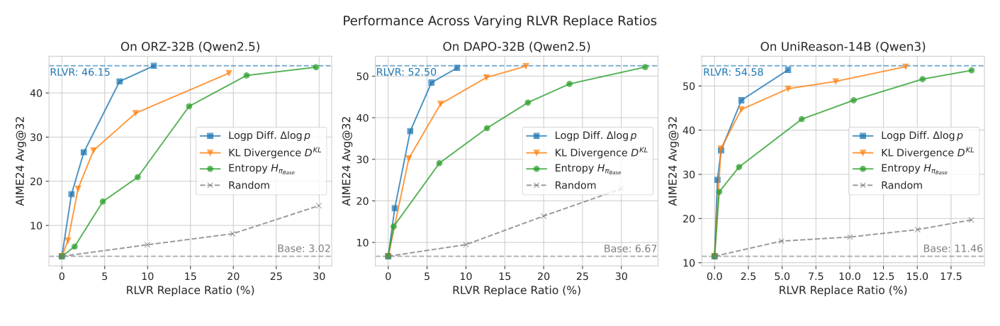

> **图 2（Figure 2）**：不同指标与不同模型对上的 token 替换性能。虽然所有指标最终都能恢复 RLVR 级别的准确率，但 $\Delta \log p$ 所需的替换次数最少，这表明它能精确分离出被 RLVR 训练改变的、少数对推理至关重要的 token。
>
> （图题：“不同 RLVR 替换比例下的性能”；三个子图分别为 ORZ-32B (Qwen2.5)、DAPO-32B (Qwen2.5)、UniReason-14B (Qwen3)；横轴为 RLVR 替换比例 (%)，纵轴为 AIME24 Avg@32；曲线为 Logp 差 $\Delta\log p$、KL 散度 $\bar D^{KL}$、熵 $\mathcal{H}_{Base}$ 与随机替换。基座/RLVR 分数分别为：ORZ 3.02/46.15，DAPO 6.67/52.50，UniReason 11.46/54.58。）

### 3.1 统计分析：方向性指标与基于幅度的指标（Statistical Analysis: Directional vs. Magnitude-Based Metrics）

**实验设置。** 我们对若干 RLVR–基座模型对（ORZ（Hu et al., 2025a）、DAPO（Yu et al., 2025）、UniReason（Huan et al., 2025））的输出进行统计分析，比较不同 token 级指标捕捉 RLVR 所致变化的能力。我们在 AIME-24 数据集上绘制了不同模型所生成 token 的熵、散度和对数概率差的直方图。

**统计比较。** 图 1(b) 展示了 UniReason 模型对上这些指标的分布。在所有指标上，直方图都在零附近呈尖峰状（注意 y 轴为对数刻度），证实了 RLVR 所致变化是稀疏的。¹ 然而，熵和 KL 散度的分布在基座模型与 RLVR 模型的输出上几乎完全相同。相反，$\Delta \log p$ 的分布呈现出两条明显的尾部：正尾对应 RLVR 模型偏好的 token，负尾对应基座模型偏好的 token。这一模式在所有测试的模型对以及多种熵/散度变体上都成立（附录 E）：基于幅度的指标在 RLVR 模型和基座模型所生成 token 上的分布几乎无法区分（图 13–15），而 $\Delta \log p$ 始终呈现清晰的双峰模式（图 12）。

这是因为仅度量幅度的指标只量化了分布变化的大小，而忽略了它的方向，即某个给定 token 是更受 RLVR 模型青睐还是更受基座模型青睐。借助方向信息，$\Delta \log p$ 揭示了两种模式之间的清晰差异，从而能够更精确地识别 RLVR 引起的稀疏、增强推理的更新；我们将在下一节验证这些更新对推理性能的影响。

> ¹ Wang et al. (2025b) 认为 RLVR 主要修改高熵 token。因此，在他们的假设下，观察到的近零熵 token 的集中现象与稀疏更新是一致的。

### 3.2 通过选择性 token 替换恢复 RLVR 性能（Recovering RLVR Performance via Selective Token Replacement）

**token 替换设置。** 为了进一步评估各指标所识别出的少数 token 如何影响推理能力，我们开展了由 Meng et al. (2026) 提出的**选择性 token 替换**²实验。在每个解码步，我们先从 $\pi_{Base}$ 中采样一个 token，然后应用特定于指标的判据 $f^\tau$ 来决定是否用一个从 $\pi_{RL}$ 中采样的 token 替换它（算法 1）。通过调整阈值 $\tau$ 来控制不同指标的替换率，从而实现公平比较。

我们比较熵、KL 散度³和对数概率差，对应的替换判据函数定义如下：

- **熵**：遵循“RLVR 更新以高熵位置为目标”的假设（Wang et al., 2025b），如果基座模型在该位置的 token 分布的熵超过阈值 $\tau$，则替换该 token：
  $$f^\tau_{\mathcal{H}}(y_t\mid x, y_{<t}) = \mathbb{I}\big(\mathcal{H}(\cdot\mid x, y_{<t}) > \tau\big).$$
- **KL 散度**：类似地，为了针对两个模型分歧最大的位置，若散度大于 $\tau$ 则替换该 token：
  $$f^\tau_{D}(y_t\mid x, y_{<t}) = \mathbb{I}\big(D(\cdot\mid x, y_{<t}) > \tau\big).$$
- **对数概率差**：某个 token $y_t$ 若具有很大的负 $\Delta \log p$，说明 RLVR 已学会相对于基座模型对其进行惩罚。我们利用这一点，替换对数概率差低于阈值 $\tau$ 的 token：
  $$f^\tau_{logp}(y_t\mid x, y_{<t}) = \mathbb{I}\big(\Delta \log p(y_t\mid x, y_{<t}) < \tau\big).$$

> **算法 1（Algorithm 1）：选择性 token 替换（Selective Token Replacement）**
>
> **输入：** 基座模型与 RLVR 模型 $\pi_{Base}, \pi_{RL}$，提示 $x$，判据函数 $f^\tau(\cdot) \in \{0, 1\}$
> 1. 初始化回复：$t \leftarrow 0$，$y_{\le 0} \leftarrow$ “”
> 2. **while** $y_t \ne$ “<EOS>” **do**
> 3. 　$t \leftarrow t + 1$
> 4. 　从基座模型采样：$y_t \sim \pi_{Base}(\cdot\mid x, y_{<t})$
> 5. 　**if** $f^\tau(y_t\mid x, y_{<t}) = 1$ **then**
> 6. 　　替换该 token：$y_t \sim \pi_{RL}(\cdot\mid x, y_{<t})$
> 7. 　**end if**
> 8. **end while**
> 9. **return** $y_{\le t}$

这种由特定于指标的阈值控制的选择性替换设置，使我们能够在相同替换率下，比较各指标所识别出的 token 对推理性能的影响。图 2 展示了三种代表性指标 $\mathcal{H}_{\pi_{Base}}$、$\bar{D}^{KL}$ 和 $\Delta \log p$ 在 AIME-24 上的结果；附录 A.2 中的图 6 给出了包含更多指标的消融实验，包括 RLVR 模型的熵 $\mathcal{H}_{\pi_{RL}}$ 和 KL 散度的各种变体。所有指标都与一个均匀随机替换 token 的随机基线进行对比：$f^\tau_{rand}(\cdot) = \mathbb{I}_{\rho\sim U[0,1]}(\rho < \tau)$。主要观察如下：

**观察 I：有选择地替换少数基座模型 token 即可恢复 RLVR 的性能。** 如图 2 所示，使用不同指标替换基座模型 5%–30% 的采样 token，就足以达到最终 RLVR 模型的准确率。相比之下，不经指标选择而随机替换 token，性能增长要慢得多。这表明，被 RLVR 修改的 token 在序列中分布稀疏，但对推理的重要性却不成比例地高，也凸显了所评估的指标在识别这些关键 token 方面的有效性。

**观察 II：在识别 RLVR 学到的推理模式方面，对数概率差 > 散度 > 熵。** 在所有模型对上（图 2），基于 $\Delta \log p$ 的替换以最少的替换（约 10% 的 token）达到 RLVR 模型的准确率。相比之下，仅度量幅度的指标（如散度和熵）需要明显更多的替换才能达到 RLVR 的性能，说明它们在识别 RLVR 引入的推理关键变化方面精度较低。在这两者之间，散度始终优于熵，这表明 RLVR 的变化可能并不局限于高熵位置。这一排序——$\Delta \log p$ 最高，散度次之，熵最低——在不同的散度与熵变体上都保持稳定（附录 A.2 的图 6），进一步验证了对数概率差在分离最具影响力位置方面的优越性。

> ² 该实验沿用了 Meng et al. (2026) 的交叉采样（cross-sample）实验，原实验采用双向 token 交换来验证 RL 的稀疏性。我们使用“选择性 token 替换”这一术语，以更好地反映我们的具体设置：比较不同指标如何选择需要被 $\pi_{RL}$ 替换的基座 token。
>
> ³ 在 token 替换中，我们主要使用平均 KL 散度 $\bar{D}^{KL} = \frac{1}{2}\big(D^{KL}_{\pi_{RL},\pi_{Base}} + D^{KL}_{\pi_{Base},\pi_{RL}}\big)$ 以避免潜在的非对称性偏差，并在消融研究中纳入 KL 的变体 $D^{KL}_{\pi_{RL},\pi_{Base}}$ 和 $D^{KL}_{\pi_{Base},\pi_{RL}}$。

### 3.3 稀疏更新的梯度解释（A Gradient-Based Explanation for the Sparse Updates）

前面的分析已经确立：RLVR 模型与其基座模型的差异体现在一小部分关键 token 上，而 $\Delta \log p$ 能最有效地识别这些 token。这里，我们为这种变化的稀疏性提供一种基于梯度的解释：**RLVR 的策略梯度天然地把更新集中在罕见的低概率 token 上，而这些 token 与最终模型中 $\Delta \log p$ 较高的 token 相关联。**

**RLVR 的策略梯度稀疏地集中在低概率 token 上。** 对于一个未被裁剪的 token $y_{i,t}$，DAPO 目标 $\mathcal{J}_{DAPO}$ 的梯度可写为 $w_{i,t}\cdot\nabla_\theta \log \pi_\theta(y_{i,t}\mid x, y_{i,<t})$，其中 $w_{i,t} = r_{i,t}(\theta)\hat{A}_{i,t}$ 综合了重要性采样比率和优势。为分析该 token 的梯度范数，我们有如下引理（证明见附录 D）：

> **引理 3.1（Lemma 3.1）.** 对于 softmax 参数化的 LLM 策略，设输出 token $y_{i,t}$ 对应的 logits 向量为 $z$，则 DAPO 目标关于 $z$ 的梯度的 $\ell_1$ 范数为：
> $$
> \big\|\nabla_z \mathcal{J}_{DAPO}(y_{i,t}\mid x, y_{i,<t})\big\|_1 = 2|w_{i,t}|\cdot\big(1 - \pi_\theta(y_{i,t}\mid x, y_{i,<t})\big).
> $$

该偏梯度的 $\ell_1$ 范数直接取决于 $1 - \pi_\theta(y_i\mid x, y_{i,<t})$：token 概率越低，梯度越大。此外，Yang et al. (2025b) 形式化地证明了完整梯度范数被 $1 - \pi_\theta(\cdot)$ 项紧致地界定。因此，低概率 token 尽管罕见，却获得了不成比例的大梯度更新。我们在图 3(a) 中对此进行了实证佐证，该图绘制了 DAPO 训练中某个中间步的 token 概率及其梯度系数。尽管低概率 token 很少被采样到，它们却占据了总梯度质量的大部分。这种梯度集中解释了为什么 RLVR 的修改是稀疏的：学习天然地聚焦在一小组高影响力的低概率位置上。

**高 $\Delta \log p$ 的 token 正是被更新的低概率 token。** 为完成论证，我们将主导训练更新的低概率 token 与最终模型中高 $\Delta \log p$ 的 token 联系起来。图 3(b) 按 $\Delta \log p$ 取值对 token 分组进行分析，揭示出两种模式：第一，高 $\Delta \log p$ 分组中 token 的概率从基座模型到 RLVR 模型大幅上升；第二，这些高 $\Delta \log p$ 的 token 在两个模型中的概率都明显更低。这证实了 RLVR 学到的最显著更新以这些低概率 token 为目标；因此，RLVR 变化的稀疏性是作用于这些关键 token 的稀疏、大幅度梯度的直接结果，而这些 token 可以通过事后（post-hoc）观察其较大的 $\Delta \log p$ 来有效识别。

**在训练中排除低概率 token 会损害性能。** 为了因果性地验证这些低概率 token 的重要性，我们进行了一项训练时干预实验，为我们的假设提供直接证据。我们使用 DAPO 训练 Qwen2.5-Math-7B 基座模型（Yang et al., 2024），但在 rollout 时采用 top-p 采样策略来过滤掉低概率 token。图 3(c) 中的结果非常明确：即便是温和的过滤（例如 top-p=0.95），与默认设置（top-p=1.0）相比也会导致性能大幅下降；随着过滤变得更激进（即 top-p 阈值更低），性能急剧下降。该实验表明，这些低概率 token 不仅与梯度大小相关，而且对 RLVR 训练所取得的推理提升是**必不可少**的。


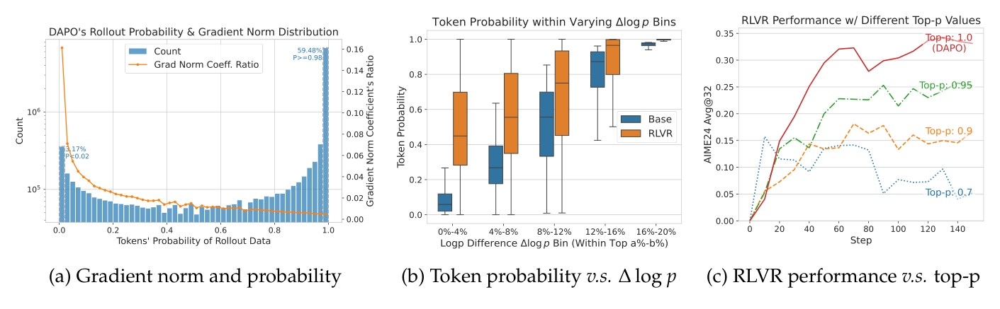

> **图 3（Figure 3）**：(a) DAPO 某一步中的 token 概率与梯度范数系数 $1 - \pi_\theta(\cdot)$，梯度集中在罕见的低概率 token 上。(b) 不同 $\Delta \log p$ 分组内的 token 概率，$\Delta \log p$ 越高的分组，在基座模型和 RLVR 模型中的概率都越低。(c) top-p 过滤对 RLVR 训练性能的影响：过滤越多，性能越差。
>
> （子图 (a) 标注：概率 $P<0.02$ 的 token 占 3.17%，$P\ge 0.98$ 的 token 占 59.48%；子图 (b) 横轴为“对数概率差 $\Delta\log p$ 分组（位于前 a%–b%）”，从 0%–4% 到 16%–20%；子图 (c) 比较 top-p = 1.0（DAPO）、0.95、0.9、0.7 的 AIME24 Avg@32 训练曲线。）

> **要点总结（Takeaway）**
>
> 1. **RLVR 的收益来自稀疏而高影响力的修改。** 我们的分析表明，RLVR 的性能提升并非源于全局的分布偏移，而是源于对少数 token 有针对性的、高影响力的改变。
> 2. **对数概率差能精确定位这些稀疏变化。** 通过捕捉从基座模型到 RLVR 模型的概率偏移方向，对数概率差在分离 RLVR 所学到的推理关键 token 方面，优于熵或散度等仅度量幅度的指标。
> 3. **稀疏性源于 RLVR 对低概率 token 的关注。** 这种稀疏差异可以用 RLVR 梯度天然集中于罕见低概率 token 来解释：这使得这些 token 成为改进的焦点，也是我们观察到的稀疏、高 $\Delta \log p$ 变化的来源。

---

## 4 利用 RLVR 的方向性更新提升推理（Exploiting RLVR's Directional Updates to Boost Reasoning）

第 3 节借助 $\Delta \log p$ 分离出了稀疏且具有方向性的更新。在此基础上，我们提出两种利用这种方向性学习的实用策略：(i) **测试时选择性外推**，在关键 token 上沿学到的方向进一步移动概率质量；(ii) **训练时优势重加权**，优先考虑由高 $\Delta \log p$ 所指示的低概率 token。两种方法都通过利用 RLVR 的方向性机制，为提升性能提供了实用途径。

### 4.1 基于外推的测试时增强（Test-Time Enhancement via Extrapolation）

**沿 $\Delta \log p$ 方向的选择性测试时外推。** 我们的 token 替换实验表明，$\Delta \log p$ 能有效识别 RLVR 的推理关键变化。这自然引出一个问题：**我们能否超越简单的替换，主动放大这些关键变化，从而超过 RLVR 模型的性能？** 为此，我们实例化了一种 token 级外推：将 $\Delta \log p = \log \pi_{RL}(\cdot) - \log \pi_{Base}(\cdot)$ 视为一个学到的、从基座分布指向 RLVR 分布的“推理方向”。我们的策略是沿该方向进一步外推 RLVR 模型的分布，以放大这一信号。外推策略 $\pi^\gamma_{Extra}$ 定义为：

$$
\begin{aligned}
\log \pi^\gamma_{Extra}(y_t\mid x, y_{<t}) &:= \log \pi_{RL}(y_t\mid x, y_{<t}) + \gamma\cdot\Delta \log p(y_t\mid x, y_{<t}) + z(x, y_{<t}) \\
&= (1+\gamma)\cdot\log \pi_{RL}(y_t\mid x, y_{<t}) - \gamma\cdot\log \pi_{Base}(y_t\mid x, y_{<t}) + z(x, y_{<t}),
\end{aligned} \tag{7}
$$

其中 $\gamma$ 是控制外推强度的超参数，$z(\cdot)$ 是对数配分函数。在概率空间中，这等价于对 RLVR 分布进行重加权：

$$
\pi^\gamma_{Extra}(y_t\mid x, y_{<t}) \propto \pi_{RL}(y_t\mid x, y_{<t})\cdot\exp\big(\gamma\,\Delta \log p(y_t\mid x, y_{<t})\big).
$$

这一表述将我们的方法与奖励引导解码（reward-guided decoding）的文献（Khanov et al., 2024; Liu et al., 2024; Xu et al., 2025）联系起来，在这些工作中，奖励函数被用来对概率分布进行重加权。因此，在这一框架下，我们的 $\Delta \log p$ 充当了一种鼓励更好推理的 token 级奖励。

**为什么要“选择性”？** RLVR 的改进集中在少数 token 上，大多数位置的 $\Delta \log p$ 可以忽略不计。全局干预有扭曲那些已经校准良好的 token 的风险。因此，我们有选择地进行外推：使用 $f^\tau_{logp}$ 来筛选出具有较大负 $\Delta \log p$ 的位置，并且只在这些位置上从外推策略 $\pi^\gamma_{extra}$ 中采样（即在算法 1 第 6 行中用它替代 $\pi_{RL}$）。

**实证设置。** 我们使用 ORZ、DAPO 和 UniReason 模型对，在 AIME-24 基准上评估我们的方法，每道题生成 32 个样本（更多细节见附录 A.1）。为了隔离我们策略的影响，我们比较三种方法：(1) **RLVR**：原始的、未经干预的 RLVR 模型 $\pi_{RL}$；(2) **选择性替换（Selective Replace）**：基座模型，部分 token 被 $\pi_{RL}$ 替换；(3) **选择性外推（Selective Extrapolate）**：基座模型，部分 token 被 $\pi^\gamma_{Extra}$ 替换。为进行受控比较，(2) 和 (3) 使用相同的选择判据，唯一的区别在于是否外推。

**结果。** 在 AIME-24 上，在相同门控条件下，选择性外推在 ORZ-32B、DAPO-32B 和 UniReason-14B 上都取得了高于 $\pi_{RL}$ 的 Avg@32（32 个样本的平均值）（图 4）。相比之下，在相同判据下，选择性替换只能追平而无法超越 RL 基线。这些结果表明，沿 $\Delta \log p$ 超越 $\pi_{RL}$ 继续前进，能够带来推理准确率的增量提升。


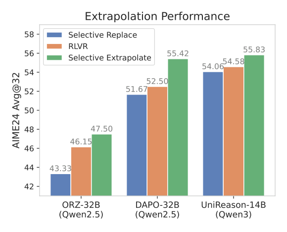

> **图 4（Figure 4）**：外推性能。
>
> 【根据图中数值重排，AIME24 Avg@32】
>
> | 模型 | 选择性替换 | RLVR | 选择性外推 |
> |---|---|---|---|
> | ORZ-32B (Qwen2.5) | 43.33 | 46.15 | 47.50 |
> | DAPO-32B (Qwen2.5) | 51.67 | 52.50 | 55.42 |
> | UniReason-14B (Qwen3) | 54.06 | 54.58 | 55.83 |

**在 $\pi_{RL}$ 上进行外推。** 我们还直接在 $\pi_{RL}$ 上（而不是在算法 1 第 4 行的 $\pi_{Base}$ 上）应用选择性外推。随着 $f^\tau_{logp}$ 中阈值 $\tau$ 的增大，AIME-24 性能在干预比例达到中等水平之前持续提升，之后收益趋于平稳（表 1）。这一模式与稀疏性发现一致：放大有限的一组推理关键 token 是有效的，而激进的干预则收益递减。

> **表 1（Table 1）**：在 RLVR 模型（DAPO-32B）而非基座模型上进行选择性外推（$\gamma = 0.1$）。
>
> | 替换比例 | 0.0% | 1.8% | 5.2% | 20.0% |
> |---|---|---|---|---|
> | Avg@32 | 52.50 | 53.96 | 55.31 | 55.10 |
> | 阈值 $\tau$ | N/A | -0.5 | -0.2 | 0.0 |

**理论依据。** 遵循 LLM 强化学习训练理论分析中的标准简化（Munos et al., 2024; Shi et al., 2025; Huang et al., 2025），我们考虑一个表格型 softmax bandit 策略：$\pi_\theta(y\mid x) \propto \exp(\theta_{x,y})$，其中 logit 由 $\theta$ 针对每个提示–回复对 $(x, y)$ 单独参数化。参照 Cui et al. (2025)，我们假设该策略使用自然策略梯度（Natural Policy Gradient，NPG（Kakade, 2001））训练，因为其更新类似于 PPO（Schulman et al., 2017）的受控优化。通过回溯（backtracking），NPG 的更新规则简化为：$\theta^{t+1}_{x,y} - \theta^t_{x,y} = \eta\cdot A^t(x, y)$，其中 $\eta$ 为步长，$A^t$ 为优势函数（Agarwal et al., 2021）。在此背景下，我们的外推策略（式 7）定义为 $\pi_{\omega(\theta^t,\gamma)}$，其中 $\omega(\theta^t, \gamma) = \theta^t + \gamma(\theta^t - \theta^0)$。在这些条件下，我们有如下定理（证明见附录 D）：

> **定理 4.1（Theorem 4.1）.** 对于给定提示 $x$，若表格型 softmax 策略 $\pi_{\theta^t}$ 通过自然策略梯度（Kakade, 2001）进行更新，则外推策略 $\pi_{\omega(\theta^t,\gamma)}$ 满足：
> $$
> \exists\,\gamma > 0,\quad \mathbb{E}_{y\sim\pi_{\omega(\theta^t,\gamma)}(\cdot\mid s)}[R_{x,y}] \ge \mathbb{E}_{y\sim\pi_{\theta^t}(\cdot\mid s)}[R_{x,y}].
> $$
> 当且仅当奖励 $R_{x,y}$ 对所有 $y$ 为常数时取等号。

该定理表明，在简化设定下，沿 $\Delta \log p$ 所学到的差异方向进行外推可以提升期望奖励。不过需要指出，该证明依赖于理想化的 NPG 更新规则，即学习过程是单调的、始终沿奖励方向调整 logits。相比之下，我们的实证分析表明，RLVR 学到的更新只集中在少数 token 上，大多数 token 上的 $\Delta \log p$ 可以忽略不计。这种差异促使我们只在差异显著的位置上进行选择性外推，因为这些位置才表现出理论所假设的一致、方向性的更新。

### 4.2 基于优势重加权的训练时增强（Training-Time Enhancement via Advantage Reweighting）

**基于概率感知优势重加权的训练时增强。** 我们的测试时方法是在事后放大已学到的推理信号，而训练时策略则是在学习过程中主动加强模型的推理信号。我们不再对最终的对数概率差 $\Delta \log p$ 进行外推，而是利用观察到的高 $\Delta \log p$ 与低概率 token 之间的相关性（图 3(b)），提出放大这些关键低概率 token 的学习信号。由于在策略梯度方法中参数更新由优势项 $\hat{A}_{i,t}$ 驱动，我们修改 DAPO（式 4）中的优势，使其优先考虑低概率 token：

$$
\tilde{A}_{i,t} = \Big[1 + \alpha\cdot\big(1 - \pi_{\theta_{old}}(y_{i,t}\mid x, y_{i,<t})\big)\Big]\cdot\hat{A}_{i,t}, \tag{8}
$$

其中 $\alpha$ 是控制重加权强度的超参数。这种对低概率 token 的关注也与图 3(c) 中的 top-p 实验相吻合，该实验发现低概率 token 对 RLVR 训练是不可替代的。

**实验设置。** 我们只修改标准 DAPO 配方中的优势（式 8），其余超参数全部保持不变。我们在三个数学推理基准上评估模型性能：AIME-24、AIME-25 和 AMC。遵循 DAPO 的设置，评估时采用 top-p=0.7 进行采样。我们报告 Avg@32 与 Pass@16⁴，两者都基于每道题 32 个样本计算，以确保通过率估计稳定（Chen et al., 2021）。

> **表 2（Table 2）**：我们的重加权方法与 DAPO 在数学推理基准上的比较。
>
> | 模型 | 方法 | AIME24 Avg@32 | AIME24 Pass@16 | AIME25 Avg@32 | AIME25 Pass@16 | AMC Avg@32 | AMC Pass@16 | 平均 Avg@32 | 平均 Pass@16 |
> |---|---|---|---|---|---|---|---|---|---|
> | Qwen2.5-Math-7B | Base | 14.79 | 47.46 | 6.67 | 27.84 | 40.62 | 79.25 | 20.69 | 51.52 |
> | | DAPO | 35.73 | 54.09 | 17.6 | 30.45 | 73.04 | 89.03 | 42.12 | 57.86 |
> | | Ours | 39.06 | 60.58 | 18.54 | 36.72 | 73.64 | 89.69 | 43.75 | 62.33 |
> | Qwen3-8B-Base | Base | 5.42 | 30.63 | 5.73 | 32.8 | 27.64 | 78.09 | 12.93 | 47.17 |
> | | DAPO | 36.98 | 72.3 | 26.67 | 46.76 | 69.13 | 88.51 | 44.26 | 69.19 |
> | | Ours | 38.13 | 69.87 | 31.15 | 55.38 | 71.05 | 92.3 | 46.78 | 72.52 |

**结果：跨模型与数据集的性能提升。** 我们在两个模型上比较了重加权方法：Qwen2.5-Math-7B（Yang et al., 2024）和 Qwen3-8B-Base（Yang et al., 2025a）。如表 2 所示，提高低概率 token 的权重在所有测试的模型和数据集上一致地提升了推理准确率。值得注意的是，这种准确率（Avg@32）的提升并没有以牺牲探索能力（通常用 Pass@k 衡量）（Yue et al., 2025）为代价；事实上，平均 Pass@16 也比 DAPO 基线更高。

> **表 3（Table 3）**：不同重加权方法的结果。
>
> | 基准 | 指标 | PPL | Dominate | Ours |
> |---|---|---|---|---|
> | AIME24 | Avg@32 | 35.63 | 36.35 | 39.06 |
> | | Pass@16 | 61.95 | 55.27 | 60.58 |
> | AIME25 | Avg@32 | 16.46 | 13.02 | 18.54 |
> | | Pass@16 | 32.19 | 20.69 | 36.72 |
> | AMC | Avg@32 | 72.06 | 79.97 | 73.64 |
> | | Pass@16 | 89.1 | 84.93 | 89.69 |
> | 平均 | Avg@32 | 41.38 | 43.11 | 43.75 |
> | | Pass@16 | 61.08 | 53.63 | 62.33 |

**不同重加权方法的比较。** 我们的重加权方法源于低概率 token 的关键作用，而已有工作基于不同的假设提出了其他重加权策略：(1) **PPL**：Deng et al. (2025) 发现 RLVR 更新偏好低困惑度（low-ppl）的回复，因此他们对优势进行重加权以增强这些回复：$\tilde{A}^{ppl}_{i,t} = [1 - \alpha\cdot w_{ppl}(y_i)]\cdot\hat{A}_{i,t}$，其中 $w_{ppl}(y_i)$ 是归一化的 log-PPL 权重。(2) **Dominate**：Yang et al. (2025b) 认为 RLVR 训练可能被低概率 token 过度主导，因此提出通过提高高概率 token 的权重来抵消这种影响：$\tilde{A}^{dom}_{i,t} = [\alpha\cdot\pi_\theta(y_{i,t}) + 1 - \alpha]\cdot\hat{A}_{i,t}$。我们使用这些方法推荐的超参数实现它们，并在 Qwen2.5-Math-7B 上比较性能。如表 3 所示，我们直接放大低概率 token 的方法在 Avg@32 和 Pass@16 上都取得了最佳的整体性能。图 5 中的训练动态提供了进一步的洞见：我们的方法不仅推理准确率更高，回复长度也稳步增加。性能与长度的同步提升是有效推理 RLVR 训练的一个关键模式（Guo et al., 2025），这表明我们的方法促进了推理行为。此外，$\tilde{A}^{dom}_{i,t}$ 重加权的训练熵明显更低，因为他们采用了比 DAPO 默认值 $\epsilon_{high} = 0.28$ 更严格的 clip-higher 比率 $\epsilon_{high} = 0.24$⁵。更低的熵（更少的探索）也解释了它们在表 3 中较差的 Pass@k 表现。


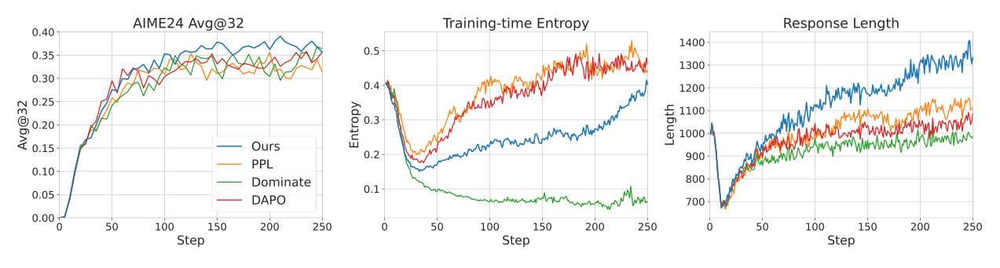

> **图 5（Figure 5）**：不同重加权方法在 Qwen2.5-Math-7B 上的训练曲线。（三个子图依次为 AIME24 Avg@32、训练时熵、回复长度随训练步数的变化，对比 Ours、PPL、Dominate 与 DAPO。）

> ⁴ 由于只有 32 个样本，我们在 Pass@k 评估中报告更稳定的 Pass@16，而非 Pass@32。
>
> ⁵ 这遵循了其论文中的推荐值（Yang et al., 2025b）。我们也测试了默认的 $\epsilon_{high} = 0.28$，但它导致训练不稳定。

---

## 5 相关工作（Related Work）

**面向 LLM 的强化学习。** 强化学习是 LLM 后训练流程中的关键组成部分。早期应用以基于人类反馈的强化学习（RLHF）为中心，用于模型对齐（Ouyang et al., 2022; Stiennon et al., 2020）；而近期进展则将重点转向用 RL 构建推理模型。OpenAI o1（Jaech et al., 2024）是首个推理模型，DeepSeek R1（Guo et al., 2025）则给出了使用 GRPO 算法（Shao et al., 2024）构建推理模型的详细 RLVR（Lambert et al., 2024）配方。这些开创性工作启发了一系列后续模型的发展，既包括 Kimi（Team, 2025）、Qwen3（Yang et al., 2025a）和 Gemini 2.5（Comanici et al., 2025）等工业系统，也包括 Dr.GRPO（Liu et al., 2025）、Open-Reasoner-Zero（Hu et al., 2025a）、DAPO（Yu et al., 2025）、GSPO（Zheng et al., 2025）和 QAE（Wu et al., 2025）等开源学术算法，用以进一步提升推理能力。在本文中，我们采用 DAPO 作为基线 RLVR 算法。

**理解 RLVR 的作用。** RLVR 的成功催生了一系列致力于理解其作用的研究。早期工作分析了 RLVR 训练模型的高层认知行为（Gandhi et al., 2025; Hu et al., 2025b; Bogdan et al., 2025），而近期研究则通过 token 级量化深化了分析（Qian et al., 2025; Wang et al., 2025a）。Cui et al. (2025) 研究了 RLVR 过程中的 token 熵变化，Yang et al. (2025b) 量化了特定 token 的梯度范数，Deng et al. (2025) 和 Meng et al. (2026) 则使用 token 替换来度量其对推理性能的影响。这些分析的一个核心发现是 RLVR 会引起稀疏更新，这一点已通过高熵 token（Wang et al., 2025b）、KL 散度（Huan et al., 2025）以及稀疏的梯度范数（Yang et al., 2025b; Deng et al., 2025）得到验证。然而，在研究基座模型与 RLVR 模型之间的差异时，已有研究主要关注变化的幅度，在很大程度上忽视了其方向。虽然（Yang et al., 2025b）分析了每个梯度步上概率的更新方向（增加或减少），但我们将更新方向的概念扩展到了从基座模型到 RLVR 模型的完整分布偏移，并提出在分布空间中沿这一学到的方向进行显式外推。

---

## 6 结论（Conclusion）

在本工作中，我们提出了一种基于对数概率差 $\Delta \log p$ 的 RLVR 方向性分析，并证明它在识别稀疏但对推理至关重要的更新方面，比基于幅度的指标（如散度或熵）更有效。在此基础上，我们提出了用于放大这些方向性更新的测试时外推方法，以及将学习聚焦于 $\Delta \log p$ 所突出的低概率 token 的训练时重加权方法。两种方法都在不同设置下提升了推理性能，验证了我们的核心原则：**依据更新方向来诊断和改进 RLVR**。

**局限性与未来工作。** 我们的外推方法的一个主要局限是需要两个模型；未来工作可以将其与参数高效微调相结合以降低计算成本。外推还引入了额外的超参数，未来工作可以探索将选择阈值与外推强度结合起来，实现更自适应的外推。此外，我们的重加权方法可以在不同模型规模上进行评估，或与其他自适应训练技术结合。

---

## 贡献（Contributions）

**作者：** Kexin Huang, Haoming Meng, Junkang Wu, Jinda Lu, Chiyu Ma, Ziqian Chen, Xue Wang, Bolin Ding, Jiancan Wu, Xiang Wang, Xiangnan He, Guoyin Wang, and Jingren Zhou.

---

## 参考文献（References）

> 按翻译惯例，参考文献条目保留英文原文，不作翻译。

- Alekh Agarwal, Sham M. Kakade, Jason D. Lee, and Gaurav Mahajan. On the theory of policy gradient methods: Optimality, approximation, and distribution shift. *Journal of Machine Learning Research*, 22(98):1–76, 2021. URL http://jmlr.org/papers/v22/19-736.html.
- Paul C. Bogdan, Uzay Macar, Neel Nanda, and Arthur Conmy. Thought anchors: Which llm reasoning steps matter?, 2025. URL https://arxiv.org/abs/2506.19143.
- Mark Chen, Jerry Tworek, Heewoo Jun, Qiming Yuan, Henrique Ponde de Oliveira Pinto, Jared Kaplan, Harri Edwards, Yuri Burda, Nicholas Joseph, Greg Brockman, Alex Ray, et al. Evaluating large language models trained on code, 2021.
- Gheorghe Comanici, Eric Bieber, Mike Schaekermann, Ice Pasupat, Noveen Sachdeva, Inderjit Dhillon, Marcel Blistein, Ori Ram, Dan Zhang, Evan Rosen, et al. Gemini 2.5: Pushing the frontier with advanced reasoning, multimodality, long context, and next generation agentic capabilities. *arXiv preprint arXiv:2507.06261*, 2025.
- Ganqu Cui, Yuchen Zhang, Jiacheng Chen, Lifan Yuan, Zhi Wang, Yuxin Zuo, Haozhan Li, Yuchen Fan, Huayu Chen, Weize Chen, et al. The entropy mechanism of reinforcement learning for reasoning language models. *arXiv preprint arXiv:2505.22617*, 2025.
- Jia Deng, Jie Chen, Zhipeng Chen, Wayne Xin Zhao, and Ji-Rong Wen. Decomposing the entropy-performance exchange: The missing keys to unlocking effective reinforcement learning, 2025.
- Kanishk Gandhi, Ayush K Chakravarthy, Anikait Singh, Nathan Lile, and Noah Goodman. Cognitive behaviors that enable self-improving reasoners, or, four habits of highly effective STars. In *Second Conference on Language Modeling*, 2025. URL https://openreview.net/forum?id=QGJ9ttXLTy.
- Daya Guo, Dejian Yang, Haowei Zhang, Junxiao Song, Peiyi Wang, Qihao Zhu, et al. Deepseek-r1 incentivizes reasoning in llms through reinforcement learning. *Nature*, 645:633–638, 2025.
- Jingcheng Hu, Yinmin Zhang, Qi Han, Daxin Jiang, Xiangyu Zhang, and Heung-Yeung Shum. Open-reasoner-zero: An open source approach to scaling up reinforcement learning on the base model. *arXiv preprint arXiv:2503.24290*, 2025a.
- Xiao Hu, Xingyu Lu, Liyuan Mao, YiFan Zhang, Tianke Zhang, Bin Wen, Fan Yang, Tingting Gao, and Guorui Zhou. Why distillation can outperform zero-rl: The role of flexible reasoning. *arXiv preprint arXiv:2505.21067*, 2025b.
- Maggie Huan, Yuetai Li, Tuney Zheng, Xiaoyu Xu, Seungone Kim, Minxin Du, Radha Poovendran, Graham Neubig, and Xiang Yue. Does math reasoning improve general llm capabilities? understanding transferability of llm reasoning. *arXiv preprint arXiv:2507.00432*, 2025.
- Kexin Huang, Junkang Wu, Ziqian Chen, Xue Wang, Jinyang Gao, Bolin Ding, Jiancan Wu, Xiangnan He, and Xiang Wang. Larger or smaller reward margins to select preferences for LLM alignment? In *Forty-second International Conference on Machine Learning*, 2025. URL https://openreview.net/forum?id=ncTwQagrj8.
- Aaron Jaech, Adam Kalai, Adam Lerer, Adam Richardson, Ahmed El-Kishky, Aiden Low, Alec Helyar, Aleksander Madry, Alex Beutel, Alex Carney, et al. Openai o1 system card. *arXiv preprint arXiv:2412.16720*, 2024.
- Sham M Kakade. A natural policy gradient. In T. Dietterich, S. Becker, and Z. Ghahramani (eds.), *Advances in Neural Information Processing Systems*, volume 14. MIT Press, 2001.
- Maxim Khanov, Jirayu Burapacheep, and Yixuan Li. ARGS: Alignment as reward-guided search. In *The Twelfth International Conference on Learning Representations*, 2024. URL https://openreview.net/forum?id=shgx0eqdw6.
- Nathan Lambert, Jacob Morrison, Valentina Pyatkin, Shengyi Huang, Hamish Ivison, Faeze Brahman, Lester James V Miranda, Alisa Liu, Nouha Dziri, Shane Lyu, et al. Tulu 3: Pushing frontiers in open language model post-training. *arXiv preprint arXiv:2411.15124*, 2024.
- Aitor Lewkowycz, Anders Andreassen, David Dohan, Ethan Dyer, Henryk Michalewski, Vinay Ramasesh, Ambrose Slone, Cem Anil, Imanol Schlag, Theo Gutman-Solo, Yuhuai Wu, Behnam Neyshabur, Guy Gur-Ari, and Vedant Misra. Solving quantitative reasoning problems with language models. In *Proceedings of the 36th International Conference on Neural Information Processing Systems*, NeurIPS '22, Red Hook, NY, USA, 2022.
- Tianlin Liu, Shangmin Guo, Leonardo Bianco, Daniele Calandriello, Quentin Berthet, Felipe Llinares-López, Jessica Hoffmann, Lucas Dixon, Michal Valko, and Mathieu Blondel. Decoding-time realignment of language models. In *Proceedings of the 41st International Conference on Machine Learning*, volume 235 of *Proceedings of Machine Learning Research*, pp. 31015–31031. PMLR, 21–27 Jul 2024.
- Zichen Liu, Changyu Chen, Wenjun Li, Penghui Qi, Tianyu Pang, Chao Du, Wee Sun Lee, and Min Lin. Understanding r1-zero-like training: A critical perspective. *arXiv preprint arXiv:2503.20783*, 2025.
- Haoming Meng, Kexin Huang, Shaohang Wei, Chiyu Ma, Shuo Yang, Xue Wang, Guoyin Wang, Bolin Ding, and Jingren Zhou. Sparse but critical: A token-level analysis of distributional shifts in RLVR fine-tuning of LLMs. In *The Fourteenth International Conference on Learning Representations*, 2026. URL https://openreview.net/forum?id=8vWIXno8LW.
- Remi Munos, Michal Valko, Daniele Calandriello, Mohammad Gheshlaghi Azar, Mark Rowland, Zhaohan Daniel Guo, Yunhao Tang, Matthieu Geist, Thomas Mesnard, Côme Fiegel, et al. Nash learning from human feedback. In *Forty-first International Conference on Machine Learning*, 2024.
- Long Ouyang, Jeffrey Wu, Xu Jiang, Diogo Almeida, Carroll Wainwright, Pamela Mishkin, Chong Zhang, Sandhini Agarwal, Katarina Slama, Alex Ray, et al. Training language models to follow instructions with human feedback. *Advances in neural information processing systems (NeurIPS)*, 35:27730–27744, 2022.
- Chen Qian, Dongrui Liu, Haochen Wen, Zhen Bai, Yong Liu, and Jing Shao. Demystifying reasoning dynamics with mutual information: Thinking tokens are information peaks in llm reasoning. *arXiv preprint arXiv:2506.02867*, 2025.
- Yi Ren and Danica J. Sutherland. Learning dynamics of LLM finetuning. In *The Thirteenth International Conference on Learning Representations*, 2025.
- John Schulman, Filip Wolski, Prafulla Dhariwal, Alec Radford, and Oleg Klimov. Proximal policy optimization algorithms. *arXiv preprint arXiv:1707.06347*, 2017.
- Zhihong Shao, Peiyi Wang, Qihao Zhu, Runxin Xu, Junxiao Song, Xiao Bi, Haowei Zhang, Mingchuan Zhang, YK Li, Yang Wu, et al. Deepseekmath: Pushing the limits of mathematical reasoning in open language models. *arXiv preprint arXiv:2402.03300*, 2024.
- Ruizhe Shi, Runlong Zhou, and Simon Shaolei Du. The crucial role of samplers in online direct preference optimization. In *The Thirteenth International Conference on Learning Representations*, 2025. URL https://openreview.net/forum?id=F6z3utfcYw.
- Nisan Stiennon, Long Ouyang, Jeffrey Wu, Daniel Ziegler, Ryan Lowe, Chelsea Voss, Alec Radford, Dario Amodei, and Paul F Christiano. Learning to summarize with human feedback. *Advances in Neural Information Processing Systems (NeurIPS)*, 33:3008–3021, 2020.
- Kimi Team. Kimi k1.5: Scaling reinforcement learning with llms. *arXiv preprint arXiv:2501.12599*, 2025.
- Qwen Team. Qwen2.5 technical report. *arXiv preprint arXiv:2412.15115*, 2024.
- Haozhe Wang, Qixin Xu, Che Liu, Junhong Wu, Fangzhen Lin, and Wenhu Chen. Emergent hierarchical reasoning in llms through reinforcement learning. *arXiv preprint arXiv:2509.03646*, 2025a.
- Shenzhi Wang, Le Yu, Chang Gao, Chujie Zheng, Shixuan Liu, Rui Lu, Kai Dang, Xionghui Chen, Jianxin Yang, Zhenru Zhang, et al. Beyond the 80/20 rule: High-entropy minority tokens drive effective reinforcement learning for llm reasoning. *arXiv preprint arXiv:2506.01939*, 2025b.
- Junkang Wu, Kexin Huang, Jiancan Wu, An Zhang, Xiang Wang, and Xiangnan He. Quantile advantage estimation for entropy-safe reasoning. *arXiv preprint arXiv:2509.22611*, 2025.
- Yuancheng Xu, Udari Madhushani Sehwag, Alec Koppel, Sicheng Zhu, Bang An, Furong Huang, and Sumitra Ganesh. GenARM: Reward guided generation with autoregressive reward model for test-time alignment. In *The Thirteenth International Conference on Learning Representations*, 2025. URL https://openreview.net/forum?id=J0qTpmbSbh.
- An Yang, Beichen Zhang, Binyuan Hui, Bofei Gao, Bowen Yu, Chengpeng Li, Dayiheng Liu, Jianhong Tu, Jingren Zhou, Junyang Lin, Keming Lu, Mingfeng Xue, Runji Lin, Tianyu Liu, Xingzhang Ren, and Zhenru Zhang. Qwen2.5-math technical report: Toward mathematical expert model via self-improvement, 2024.
- An Yang, Anfeng Li, Baosong Yang, Beichen Zhang, Binyuan Hui, Bo Zheng, Bowen Yu, Chang Gao, Chengen Huang, Chenxu Lv, et al. Qwen3 technical report. *arXiv preprint arXiv:2505.09388*, 2025a.
- Zhihe Yang, Xufang Luo, Zilong Wang, Dongqi Han, Zhiyuan He, Dongsheng Li, and Yunjian Xu. Do not let low-probability tokens over-dominate in rl for llms. *arXiv preprint arXiv:2505.12929*, 2025b.
- Qiying Yu, Zheng Zhang, Ruofei Zhu, Yufeng Yuan, Xiaochen Zuo, Yu Yue, Weinan Dai, Tiantian Fan, Gaohong Liu, Lingjun Liu, et al. Dapo: An open-source llm reinforcement learning system at scale. *arXiv preprint arXiv:2503.14476*, 2025.
- Yang Yue, Zhiqi Chen, Rui Lu, Andrew Zhao, Zhaokai Wang, Yang Yue, Shiji Song, and Gao Huang. Does reinforcement learning really incentivize reasoning capacity in llms beyond the base model? *arXiv preprint arXiv:2504.13837*, 2025.
- Yuzhong Zhao, Yue Liu, Junpeng Liu, Jingye Chen, Xun Wu, Yaru Hao, Tengchao Lv, Shaohan Huang, Lei Cui, Qixiang Ye, et al. Geometric-mean policy optimization. *arXiv preprint arXiv:2507.20673*, 2025.
- Chujie Zheng, Shixuan Liu, Mingze Li, Xiong-Hui Chen, Bowen Yu, Chang Gao, Kai Dang, Yuqiong Liu, Rui Men, An Yang, et al. Group sequence policy optimization. *arXiv preprint arXiv:2507.18071*, 2025.

---

# 附录（Appendix）

## A 选择性 token 替换与外推（Selective Token Replacement & Extrapolation）

### A.1 实现细节（Implementation Details）

**模型。** 我们的实验使用了若干公开可用的 RLVR 训练模型，以及它们对应的 Qwen 系列基座模型（Yang et al., 2025a; Team, 2024）：

- **ORZ**：Open-Reasoner-Zero-32B 模型（Hu et al., 2025a），使用 PPO 算法从 Qwen2.5-32B 基座模型微调而来。
- **DAPO**：DAPO-Qwen-32B 模型（Yu et al., 2025），从同一个 Qwen2.5-32B 基座模型出发，但使用 DAPO 算法微调。
- **UniReason**：UniReason-Qwen3-14B-RL 模型（Huan et al., 2025），使用 GRPO 算法从 Qwen3-14B-Base 微调而来。

**采样设置。** 我们使用 AIME-24 数据集评估替换性能。我们采用每个模型默认的对话提示模板，用户提示定义如下：

```
[Question]
Please reason step by step, and put your final answer within \\boxed{}.
```

（译：[题目] 请逐步推理，并将最终答案放在 \\boxed{} 中。）

我们将采样参数设置为 top-p=0.7、temperature=1.0、最大长度 20k，每道题采样 32 个回复。答案从最后一个由 “boxed” 包裹的文本中提取，并使用 Math-Verify 进行验证。我们报告 32 个样本上的平均正确率，即 Avg@32。

**外推的超参数。** 如算法 1 所述，替换是有选择地进行的，由判据函数 $f^\tau$ 中的阈值 $\tau$ 控制；外推强度则由 $\pi^\gamma_{Extra}$ 中的参数 $\gamma$ 调节。对于图 4 中的外推结果，“选择性外推”与“选择性替换”两种方法对每个模型使用相同的超参数，汇总如下：

> **表 4（Table 4）**：外推结果（图 4）的超参数。
>
> | 模型 | $f^\tau_{logp}$ 的阈值 $\tau$ | 替换比例 | $\pi^\gamma_{Extra}$ 中的 $\gamma$ |
> |---|---|---|---|
> | ORZ | -0.4 | 10.1% | 0.1 |
> | UniReason | -0.35 | 7.5% | 0.1 |
> | DAPO | -0.3 | 11.4% | 0.05 |

### A.2 补充实验（Additional Experiments）

**更多指标。** 如第 3 节所述，我们用于 token 替换的主要指标是基座模型的熵 $\mathcal{H}_{Base}$、KL 散度 $\bar{D}^{KL}$ 和对数概率差 $\Delta \log p$。在消融研究中，我们纳入了更多指标：RLVR 模型的熵 $\mathcal{H}_{RL}$，以及两种 KL 散度变体 $D^{KL}_{\pi_{RL},\pi_{Base}}$ 和 $D^{KL}_{\pi_{Base},\pi_{RL}}$。我们将这些指标作为 DAPO 模型选择性替换的判据进行评估。通过改变各判据的阈值 $\tau$，我们控制 token 替换频率，并在图 6 中绘制 AIME-24 上的性能随替换比例的变化。如图所示，虽然这些额外指标所选择的替换也能逼近 RLVR 模型的性能，但它们仍然比 $\Delta \log p$ 需要更多的替换。这证实了在识别推理关键 token 方面的性能排序：对数概率差 > 散度 > 熵。


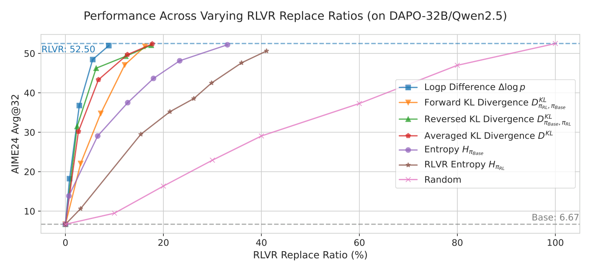

> **图 6（Figure 6）**：DAPO 在更多判据下的选择性 token 替换结果。（图题：“不同 RLVR 替换比例下的性能（DAPO-32B/Qwen2.5）”；曲线包括 Logp 差 $\Delta\log p$、正向 KL 散度 $D^{KL}_{RL,Base}$、反向 KL 散度 $D^{KL}_{Base,RL}$、平均 KL 散度 $\bar D^{KL}$、熵 $\mathcal{H}_{Base}$、RLVR 熵 $\mathcal{H}_{RL}$ 与随机替换；基座 6.67，RLVR 52.50。）

**被选中的 token。** 为了直观比较各指标，我们分析了在 DAPO 的 token 替换中，分别以熵 $\mathcal{H}_{\pi_{Base}}$、KL 散度 $\bar{D}^{KL}$ 和对数概率差 $\Delta \log p$ 为判据时，用来替换基座模型选择的那些 token。为保证公平比较，我们调整各指标的阈值，使替换率均约为 8%。图 7 展示了每种判据下排名前 50 的替换 token。可以看出，基于熵的选择偏好逻辑过渡词（如 Thus、need、can），而散度和 $\Delta \log p$ 判据使用了更多具体的数学推理 token，其中数学符号的比例更高。结合熵判据较差的表现，这表明这些具体的数学 token 在提升推理性能方面可能更有效。


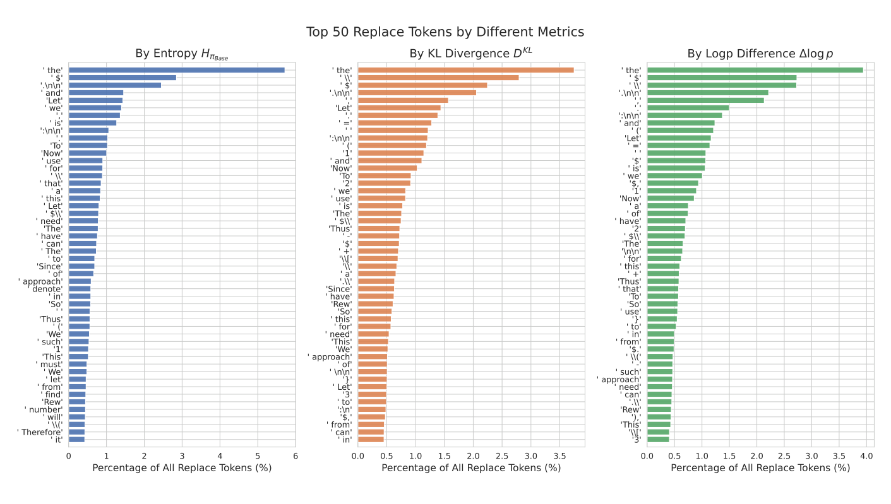

> **图 7（Figure 7）**：不同指标选择下，用于替换基座模型选择的前 50 个 token。（三个子图分别为按熵 $\mathcal{H}_{Base}$、按 KL 散度、按对数概率差 $\Delta\log p$ 选出的 token，横轴为占全部替换 token 的百分比 (%)。）

**替换过程中的逐题准确率。** 我们还在图 8 中报告了 token 替换实验中每道题的准确率变化，以更细致地考察逐步提高替换比例对模型性能的影响。我们观察到：(1) 有些题目对模型而言本身就很难，在所有替换比例下准确率都保持为零。(2) 对于其余题目，总体趋势是准确率通常随替换比例的增加而上升，然后开始波动。这与如下事实相符：当只进行 token 替换时，性能最终受限于 RLVR 模型的上限。(3) 对于少数题目，引入少量替换时准确率会先下降，随着替换比例继续增加才开始改善（例如 DAPO 的第 0 题）。对这些情况的定性检查表明，在其中一些情况下，少量被 RL 替换的 token 引入了基座模型不熟悉的 token 选项，导致基座模型无法连贯地继续生成，从而造成准确率的初期下降。然而，当我们进一步提高替换比例时，生成过程会更强地受到 RL token 的引导，模型在这些题目上的性能随之恢复并提升。


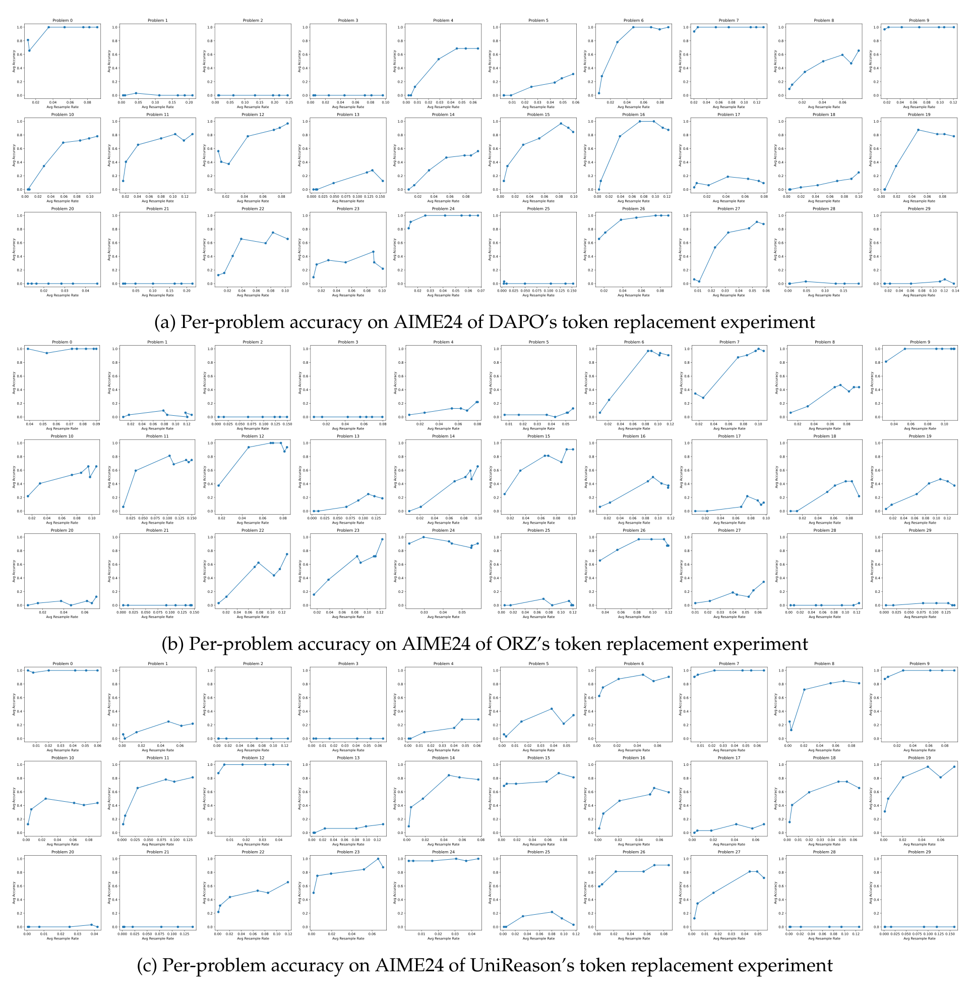

> **图 8（Figure 8）**：各模型选择性 token 替换实验中 AIME24 上的逐题准确率变化。我们报告以 $\Delta \log p$ 为选择判据时的结果。
> (a) DAPO 的 token 替换实验在 AIME24 上的逐题准确率；
> (b) ORZ 的 token 替换实验在 AIME24 上的逐题准确率；
> (c) UniReason 的 token 替换实验在 AIME24 上的逐题准确率。
> （每个小图对应一道题（Problem 0–29），横轴为平均重采样率（Avg Resample Rate），纵轴为平均准确率（Avg Accuracy）。）

### A.3 超参数敏感性分析（Hyperparameter Sensitivity Analysis）

我们的测试时外推分布 $\pi^\gamma_{Extra}$ 引入了一个超参数 $\gamma$，它决定沿学到的 $\Delta \log p$ 方向外推的强度。该干预在 token 替换流程（算法 1）内部进行，且只作用于满足判据 $\Delta \log p < \tau$ 的 token。

为验证外推相对于直接从 $\pi_{RL}$ 替换 token 所带来的性能增益是否稳健，我们对 $\gamma$ 和 token 选择阈值 $\tau$ 进行了网格搜索。我们评估 $\gamma \in \{0.05, 0.1\}$，并针对不同模型在不同范围内改变 $\tau$。对于 DAPO 和 ORZ，我们测试 $\tau \in \{-0.5, -0.4, -0.3, -0.2, -0.1\}$；对于 UniReason，由于达到 RLVR 性能水平所需的替换相对较少（图 2），我们采用更密集的网格 $\tau \in \{-0.5, -0.45, -0.4, -0.35, -0.3\}$。

如表 5 所示，在几乎所有模型和超参数设置下，外推都稳定地优于仅替换的变体，表明我们的方法具有很强的稳健性。值得注意的是，一旦替换比例高到足以达到 RLVR 的性能，进一步增加替换几乎不再带来额外收益，因为性能受限于 RLVR 模型本身。相比之下，恰当的测试时外推可以在无需任何额外训练的情况下，进一步超过 RLVR 性能 1–3 个点。

> **表 5（Table 5）**：选择性外推实验的超参数敏感性分析。∗ 标记图 4 中报告的外推结果数值，† 对应图 2 中 token 替换的终点。
>
> **(a) DAPO 在 AIME24 上的超参数与 Avg@32 性能（$\pi_{RL}$ 的 Avg@32：52.60）**
>
> | 阈值 $\tau$ | -0.5 | -0.4 | -0.3 | -0.2 | -0.1 |
> |---|---|---|---|---|---|
> | 平均替换比例 | 8.8% | 10.0% | 11.4% | 13.4% | 16.5% |
> | 用 $\pi_{RL}$ 替换 | 51.98† | 51.56 | 51.67 | 52.71 | 51.98 |
> | 外推，$\gamma = 0.05$ | 51.88 | 53.02 | 55.42∗ | 54.06 | 54.9 |
> | 外推，$\gamma = 0.1$ | 54.17 | 53.33 | 53.85 | 53.85 | 54.27 |
>
> **(b) ORZ 在 AIME24 上的超参数与 Avg@32 性能（$\pi_{RL}$ 的 Avg@32：46.15）**
>
> | 阈值 $\tau$ | -0.5 | -0.4 | -0.3 | -0.2 | -0.1 |
> |---|---|---|---|---|---|
> | 平均替换比例 | 9.5% | 10.1% | 10.8% | 11.6% | 12.7% |
> | 用 $\pi_{RL}$ 替换 | 43.65 | 43.33 | 46.15† | 44.90 | 42.81 |
> | 外推，$\gamma = 0.05$ | 47.19 | 45.52 | 45.83 | 46.25 | 43.44 |
> | 外推，$\gamma = 0.1$ | 43.75 | 47.50∗ | 45.52 | 47.08 | 45.42 |
>
> **(c) UniReason 在 AIME24 上的超参数与 Avg@32 性能（$\pi_{RL}$ 的 Avg@32：54.58）**
>
> | 阈值 $\tau$ | -0.5 | -0.45 | -0.4 | -0.35 | -0.3 |
> |---|---|---|---|---|---|
> | 平均替换比例 | 5.4% | 6.0% | 6.8% | 7.5% | 8.5% |
> | 用 $\pi_{RL}$ 替换 | 53.65† | 53.33 | 53.12 | 54.06 | 53.54 |
> | 外推，$\gamma = 0.05$ | 51.88 | 54.79 | 53.54 | 55.00 | 54.69 |
> | 外推，$\gamma = 0.1$ | 54.37 | 53.75 | 53.96 | 55.83∗ | 55.10 |
>
> 【表格结构按抽取结果重排：原文数值按列抽取，已与图 4 和表 4 中的数值核对一致。注意 (a) 中 $\pi_{RL}$ 的 Avg@32 原文写作 52.60，而正文其他位置为 52.50，此处照录原文。】

## B RLVR 训练细节（RLVR Training Details）

**超参数设置。** 我们采用开源的 DAPO 配方进行 RLVR 训练。我们的配置包括双裁剪比率（$\epsilon_{low} = 0.2$，$\epsilon_{high} = 0.28$），学习率为 1e-6，带 10 步预热（warmup）。每个 RLVR 步包含 512 个提示，每个提示采样 16 个回复，按每个 mini-batch 32 个提示进行处理，从而每步产生 16 次梯度更新。最大生成长度（以及超长惩罚阈值）对 Qwen2.5-Math-7B 设为 8k（4k），对 Qwen3-8B-Base 设为 20k（16k）。对于重加权，我们的参数 $\alpha$（式 8）对 Qwen2.5 设为 0.2，对 Qwen3 设为 0.1。遵循 Deng et al. (2025) 和 Yang et al. (2025b) 的推荐值，我们对 $\tilde{A}^{dom}_{i,t}$ 将 $\alpha$ 设为 0.1，对 $\tilde{A}^{PPL}_{i,t}$ 设为 0.01。特别地，对于 $\tilde{A}^{dom}_{i,t}$，我们还将 $\epsilon_{high}$ 调整为 0.24。

**可复现性分析。** 为了考虑 RL 过程中的随机波动，我们还在 Qwen2.5-Math-7B 骨干上为我们的重加权方法进行了四次独立的训练。图 9 展示了这些实验的学习曲线（Run 1–4，其中 Run 1 是我们在图 5 中报告的那次运行）。结果表明我们的方法具有很高的可复现性：在所有试验中，模型都达到或超过了表 3 中给出的性能水平。


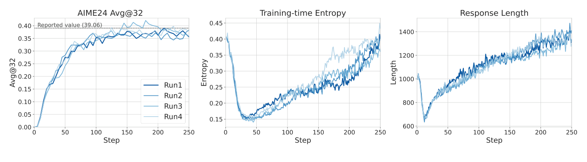

> **图 9（Figure 9）**：可复现性分析。在 Qwen2.5-Math-7B 上使用我们的重加权方法（式 8）进行的 4 次独立运行的学习曲线，显示出一致的收敛性与性能。（三个子图依次为 AIME24 Avg@32（标注报告值 39.06）、训练时熵和回复长度。）

## C 纯数学推理任务之外的性能（Performance beyond Pure-Math Reasoning Tasks）

虽然我们的模型主要在以数学为主的数据集上训练和评估，但评估它们在非数学任务上的推理能力，以考察其泛化能力，同样很重要。遵循先前工作（Zhao et al., 2025），我们使用 Minerva 数据集（Lewkowycz et al., 2022），其中包含 272 道本科水平的 STEM 题目，涵盖化学、天文学等多个学科⁶。

我们首先使用与其他评估（如 AIME24）相同的采样参数，在 Minerva 上对 RLVR 训练的模型进行基准测试。如表 6 所示，使用我们重加权方法训练的模型在推理准确率上继续优于基线。重要的是，这些提升并未以牺牲探索能力为代价，这体现在相当或更高的 Pass@k 分数上。

> **表 6（Table 6）**：RLVR 训练模型在 Minerva 上的性能。
>
> **(a) 基于 Qwen2.5-Math-7B**
>
> | 方法 | Base | DAPO | PPL | Dominate | Ours |
> |---|---|---|---|---|---|
> | Avg@32 | 18.35 | 46.43 | 48.68 | 47.01 | 49.72 |
> | Pass@16 | 61.04 | 69.44 | 68.69 | 64.59 | 70.37 |
>
> **(b) 基于 Qwen3-8B-Base**
>
> | 方法 | Base | DAPO | Ours |
> |---|---|---|---|
> | Avg@32 | 29.8 | 55.04 | 56.57 |
> | Pass@16 | 70.43 | 76.98 | 76.78 |

我们进一步在 Minerva 上评估测试时外推。由于 Minerva 比 AIME24 大得多（题目数量约为其 7 倍），对于被评估的 14B–32B 模型，我们报告 Avg@8。如图 10 所示，测试时外推稳定地提升了 RLVR 模型的准确率，验证了其在纯数学数据集之外的泛化能力。我们还在表 7 中报告了超参数网格，其中外推结果同样稳定地优于仅用 $\pi_{RL}$ 替换。


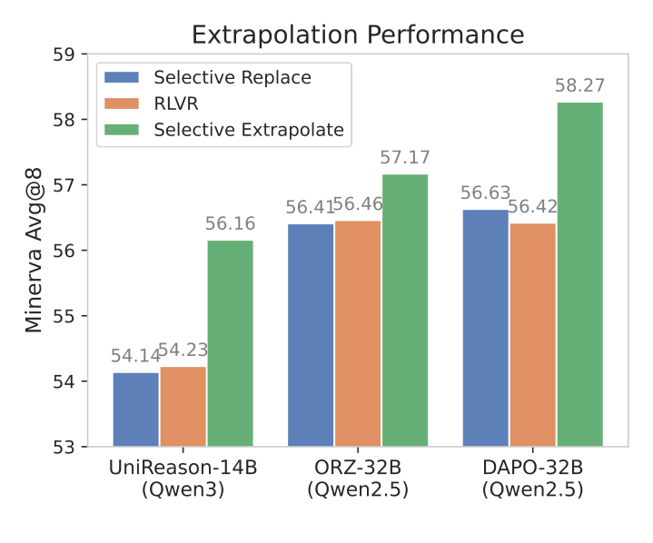

> **图 10（Figure 10）**：在 Minerva 上的外推结果。
>
> 【根据图中数值重排，Minerva Avg@8】
>
> | 模型 | 选择性替换 | RLVR | 选择性外推 |
> |---|---|---|---|
> | UniReason-14B (Qwen3) | 54.14 | 54.23 | 56.16 |
> | ORZ-32B (Qwen2.5) | 56.41 | 56.46 | 57.17 |
> | DAPO-32B (Qwen2.5) | 56.63 | 56.42 | 58.27 |

> **表 7（Table 7）**：Minerva 基准上的超参数与 Avg@8 性能。∗ 标记图 10 中采用的调优值。
>
> | 模型 | DAPO | DAPO | ORZ | ORZ | UniReason | UniReason |
> |---|---|---|---|---|---|---|
> | 阈值 $\tau$ | -1.0 | -0.9 | -1.0 | -0.9 | -1.0 | -0.9 |
> | 平均替换比例 | 6.5% | 7.0% | 9.2% | 9.6% | 1.8% | 2.2% |
> | 用 $\pi_{RL}$ 替换 | 56.63 | 56.43 | 56.41 | 56.39 | 54.00 | 54.14 |
> | 外推，$\gamma = 0.05$ | 56.8 | 57.22 | 57.17∗ | 57.08 | 54.50 | 54.50 |
> | 外推，$\gamma = 0.1$ | 58.27∗ | 56.57 | 55.51 | 55.28 | 54.32 | 56.16∗ |
>
> 【表格结构按抽取结果重排，已与图 10 数值核对一致。】

> ⁶ 该数据集在原论文中名为 OCWCourses，可在 https://openreview.net/attachment?id=IFXTZERXdM7&name=supplementary_material 获取。

## D 证明（Proofs）

**引理 3.1 的证明。** 为简化记号，这里省略上下文 $x, y_{i,<t}$。DAPO 在一个未被裁剪的 token $y_{i,t}$ 上的导数为：

$$
\begin{aligned}
\nabla_\theta \mathcal{J}_{DAPO}(y_{i,t}) &= \nabla_\theta r_{i,t}(\theta)\hat{A}_{i,t} = \nabla_\theta \frac{\pi_\theta(y_{i,t})}{\pi_{\theta_{old}}(y_{i,t})}\hat{A}_{i,t} \\
&= r_{i,t}(\theta)\hat{A}_{i,t}\cdot\nabla_\theta \log \pi_\theta(y_{i,t}) \\
&= w_{i,t}\cdot\nabla_\theta \log \pi_\theta(y_{i,t}).
\end{aligned}
$$

对于 logits 为 $z$ 的 softmax 参数化策略 $\pi_\theta$，假设 $y_{i,t}$ 对应词表 $\mathcal{V}$ 中的第 $k$ 个索引，则有：

$$
\begin{aligned}
\frac{\partial}{\partial z_j}\log \pi_\theta(y_{i,t}) &= \frac{1}{\pi_\theta(y_{i,t})}\cdot\frac{\partial}{\partial z_j}\frac{\exp(z_k)}{\sum_l \exp(z_l)} \\
&= \frac{1}{\pi_\theta(y_{i,t})}\cdot
\begin{cases}
\dfrac{\exp(z_k)\sum_l \exp(z_l) - \exp^2(z_k)}{(\sum_l \exp(z_l))^2}, & j = k \\[2ex]
\dfrac{-\exp(z_k)\exp(z_j)}{(\sum_l \exp(z_l))^2}, & j \ne k
\end{cases} \\
&= \begin{cases}
1 - \pi_\theta(\mathcal{V}_k), & j = k \\
-\pi_\theta(\mathcal{V}_j), & j \ne k
\end{cases} \\
&= \mathbb{I}(j = k) - \pi_\theta(\mathcal{V}_j).
\end{aligned}
$$

因此，$\nabla_z \mathcal{J}_{DAPO}(y_{i,t})$ 的 $\ell_1$ 范数为：

$$
\begin{aligned}
\|\nabla_z \mathcal{J}_{DAPO}(y_{i,t})\|_1 &= \|w_{i,t}\nabla_z \log \pi_\theta(y_{i,t})\|_1 \\
&= |w_{i,t}|\cdot\sum_j \big|\mathbb{I}(j = k) - \pi_\theta(\mathcal{V}_j)\big| \\
&= |w_{i,t}|\cdot\Big(1 - \pi_\theta(y_{i,t}) + \sum_{j\ne k}\pi_\theta(\mathcal{V}_j)\Big) \qquad (y_{i,t} = \mathcal{V}_k) \\
&= |w_{i,t}|\cdot 2\big(1 - \pi_\theta(y_{i,t})\big).
\end{aligned}
$$

**定理 4.1 的证明。** 令 $J(\theta_x) = \mathbb{E}_{y\sim\pi_{\theta_x}(\cdot)}[R_{x,y}]$，我们需要证明对每个 $x$：

$$
\exists\,\gamma > 0,\quad J\big(\theta^t_x + \gamma(\theta^t_x - \theta^0_x)\big) \ge J(\theta^t_x).
$$

将外推方向记为 $d^t_x = \theta^t_x - \theta^0_x$，这等价于证明 $J$ 在 $\theta^t_x$ 处沿 $d^t_x$ 的方向导数为正。

方向导数为：

$$
\nabla_{d^t_x} J(\theta^t) = \nabla_{\theta_x} J(\theta^t_x)^\top \frac{d^t_x}{\|d^t_x\|} = \frac{1}{\|d^t_x\|}\cdot\sum_y \frac{\partial J(\theta^t_x)}{\partial \theta_{x,y}}\, d^t_{x,y}.
$$

对于 softmax 策略 $\pi_{\theta_x}(y) = \exp(\theta_{x,y}) / \sum_{y'}\exp(\theta_{x,y'})$，其梯度满足：

$$
\frac{\partial \pi_{\theta_x}(y')}{\partial \theta_{x,y}} = \pi_{\theta_x}(y')\big(\mathbb{I}(y = y') - \pi_{\theta_x}(y)\big).
$$

因此 $J$ 关于 $y$ 的偏梯度为：

$$
\frac{\partial J(\theta_x)}{\partial \theta_{x,y}} = \sum_{y'} R_{x,y'}\frac{\partial \pi_{\theta_x}(y')}{\partial \theta_{x,y}} = R_{x,y}\pi_{\theta_x}(y) - \pi_{\theta_x}(y)\sum_{y'} R_{x,y'}\pi_{\theta_x}(y') = \pi_{\theta_x}(y)\big(R_{x,y} - \pi_{\theta_x}^\top R_x\big).
$$

注意在 bandit 设定下，优势为 $A^t(x, y) = R_{x,y} - \pi_{\theta^t_x}^\top R_x$，于是方向导数变为：

$$
\nabla_{d^t_x} J(\theta^t) = \frac{1}{\|d^t_x\|}\cdot\sum_y \pi_{\theta^t_x}(y)\big(R_{x,y} - \pi_{\theta^t_x}^\top R_x\big)d^t_{x,y} = \frac{1}{\|d^t_x\|}\cdot\sum_y \pi_{\theta^t_x}(y)\cdot A^t(x, y)\cdot d^t_{x,y}.
$$

下面分析 $A^t(x, y)$ 与 $d^t_{x,y}$ 的大小顺序。

在所假设的 bandit 设定下，$A^t(x, y)$ 的顺序与 $R_{x,y}$ 相同，即 $A^t(x, y_1) > A^t(x, y_2)$ 当且仅当 $R_{x,y_1} > R_{x,y_2}$。对于 $d^t_{x,y}$，我们可以用归纳法证明其顺序也与 $R_{x,y}$ 相同。

当 $t = 1$ 时，利用 NPG 的更新规则，有：

$$
d^1_{x,y} - d^1_{x,y'} = \eta\cdot\big(A^0(x, y) - A^0(x, y')\big) = \eta\cdot(R_{x,y} - R_{x,y'}).
$$

因此 $d^1_{x,y}$ 的顺序与 $R_{x,y}$ 相同。假设在第 $t$ 次迭代时 $d^t_{x,y}$ 的顺序与 $R_{x,y}$ 相同，则在第 $t+1$ 次迭代时，有：

$$
d^{t+1}_{x,y} - d^{t+1}_{x,y'} = d^t_{x,y} - d^t_{x,y'} + \eta\cdot\big(A^t(x, y) - A^t(x, y')\big) = d^t_{x,y} - d^t_{x,y'} + \eta\cdot(R_{x,y} - R_{x,y'}).
$$

于是仍有 $d^{t+1}_{x,y} > d^{t+1}_{x,y'} \iff R_{x,y} > R_{x,y'}$。由归纳法，对所有 $t$，$d^t_{x,y}$ 的顺序都与 $R_{x,y}$ 相同。

由于 $A^t(x, y)$ 与 $d^t_{x,y}$ 的顺序相同，我们可以应用切比雪夫求和不等式（Chebyshev sum inequality）得到：

$$
\Big(\sum_y \pi_{\theta^t_x}(y)\Big)\cdot\Big(\sum_y \pi_{\theta^t_x}(y)\cdot A^t(x, y)\cdot d^t_{x,y}\Big) \ge \Big(\sum_y \pi_{\theta^t_x}(y)\cdot A^t(x, y)\Big)\cdot\Big(\sum_y \pi_{\theta^t_x}(y)\cdot d^t_{x,y}\Big),
$$

当且仅当 $A^t(x, y)$ 或 $d^t_{x,y}$ 对所有 $y$ 为常数（即奖励为常数）时取等号。

注意优势的期望 $\sum_y \pi_{\theta^t_x}(y)\cdot A^t(x, y) = 0$，因此有：

$$
\nabla_{d^t_x} J(\theta^t) = \frac{1}{\|d^t_x\|}\cdot\sum_y \pi_{\theta^t_x}(y)\cdot A^t(x, y)\cdot d^t_{x,y} \ge 0.
$$

当且仅当 $R_{x,y}$ 对所有 $y$ 为常数时取等号。

## E 不同指标的统计比较（Statistical Comparison of Different Metrics）

**实证设置。** 我们评估三个 RLVR 模型：ORZ、DAPO、UniReason，以及它们对应的基座模型。对每个模型，我们在 AIME-24 数据集上为每道题生成 32 个回复，采样策略为 top-p=0.7、temperature=1.0。我们的分析聚焦于比较模型对的若干指标：基座/RLVR 模型的熵、KL 散度以及对数概率差。图 3(b) 中概率分布随不同 $\Delta \log p$ 分组的变化，也是在该设置下基于 DAPO 的生成结果测得的。

**不同指标的统计。** 我们在基座模型和 RLVR 模型的生成结果上分别计算三组 RLVR 模型对的各项指标。如图 12 所示，对数概率差 $\Delta \log p$ 的分布是双峰的：RLVR 生成文本对应一条正尾，基座模型生成文本对应一条负尾。相比之下，其他基于幅度的指标的分布几乎相同，与输出由哪个模型生成无关（图 13–15）。

**高 $\Delta \log p$ token 的词云。** 为了定性理解那些被识别为较高 $\Delta \log p$（即概率被 RLVR 训练过程大幅提升）的 token，我们为每个模型的前 100 个高 $\Delta \log p$ token 生成了词云（图 11）。如图所示，这些 token 对应与问题求解相关的词语，可分为两个清晰的类别：显式的推理动作（如 combine、break、simplify）和逻辑过渡（如 wait、think、step）。这类词汇的普遍出现表明，RLVR 模型学会了构建更有效的推理过程。


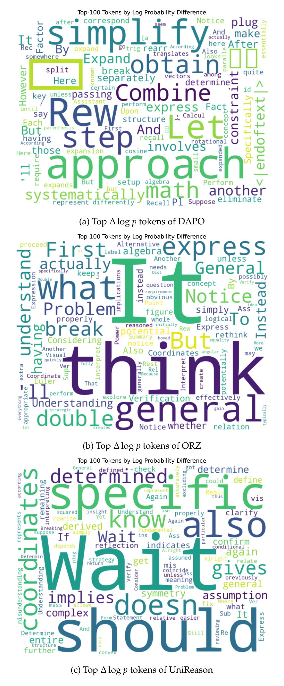

> **图 11（Figure 11）**：使用不同 RLVR 训练模型测得的高 $\Delta \log p$ token 词云。(a) DAPO 的高 $\Delta \log p$ token；(b) ORZ 的高 $\Delta \log p$ token；(c) UniReason 的高 $\Delta \log p$ token。（每个子图标题为“按对数概率差排序的前 100 个 token”。）


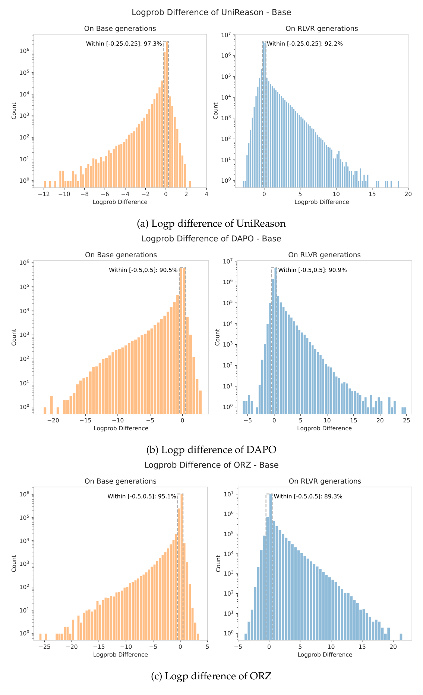

> **图 12（Figure 12）**：不同 RLVR 模型的对数概率差直方图，比较 RLVR 模型与基座模型的生成结果。（各子图分别在基座模型生成与 RLVR 模型生成上统计，并标注落在零附近小区间内的比例，例如 UniReason 在 $[-0.25, 0.25]$ 内的比例分别为 97.3% 与 92.2%，其余模型对在 $[-0.5, 0.5]$ 内的比例约为 89%–95%。）


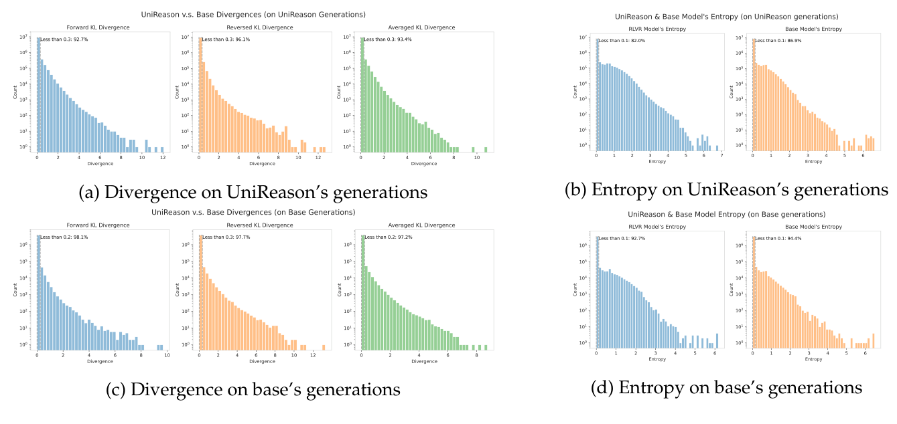

> **图 13（Figure 13）**：UniReason 及其对应基座模型的散度和熵直方图，分别在 UniReason 或基座模型的生成结果上测得。


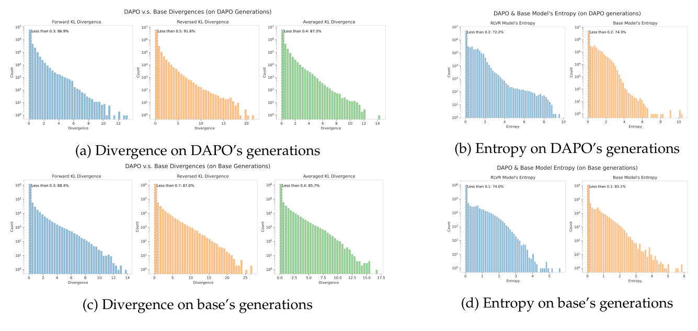

> **图 14（Figure 14）**：DAPO 及其对应基座模型的散度和熵直方图，分别在 DAPO 或基座模型的生成结果上测得。


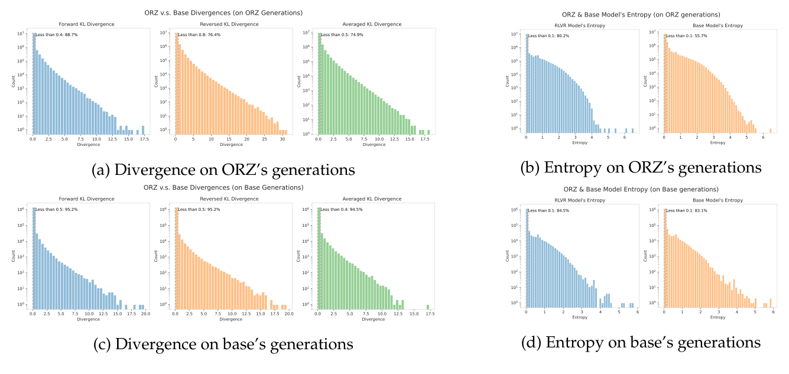

> **图 15（Figure 15）**：ORZ 及其对应基座模型的散度和熵直方图，分别在 ORZ 或基座模型的生成结果上测得。

## F 大语言模型的使用（The Use of Large Language Models）

我们仅使用 LLM 润色本文的部分语言。所有内容最初均由作者撰写。LLM 的使用仅限于改进部分已有文本，且所有修改建议都经过作者审阅，以确认其准确性并与原意保持一致。
